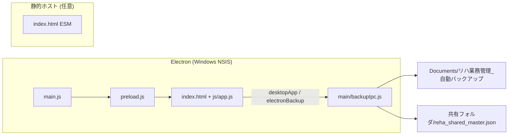
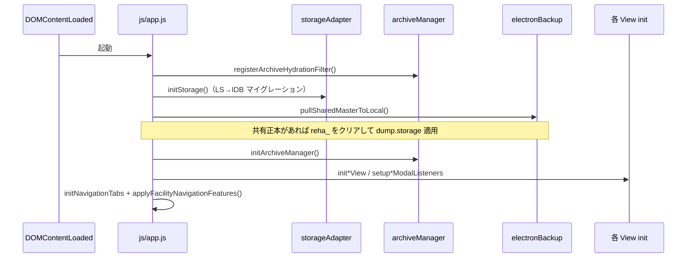
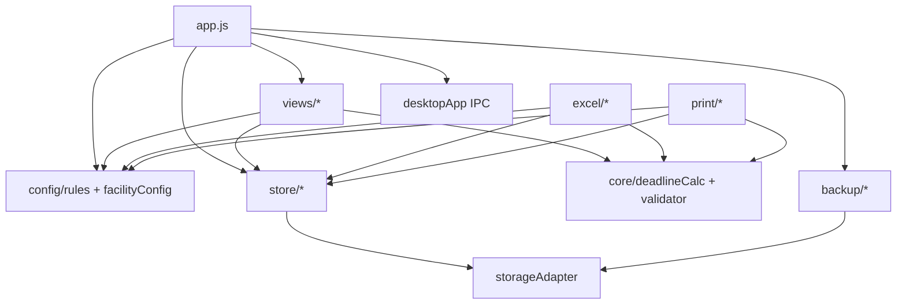
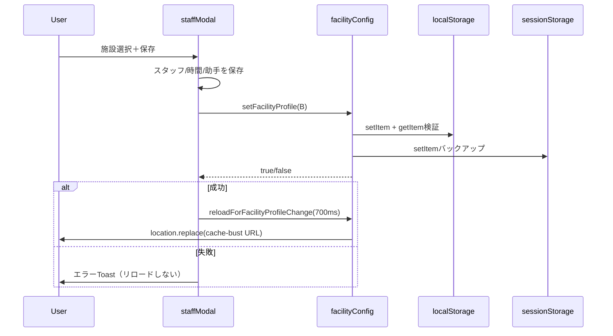
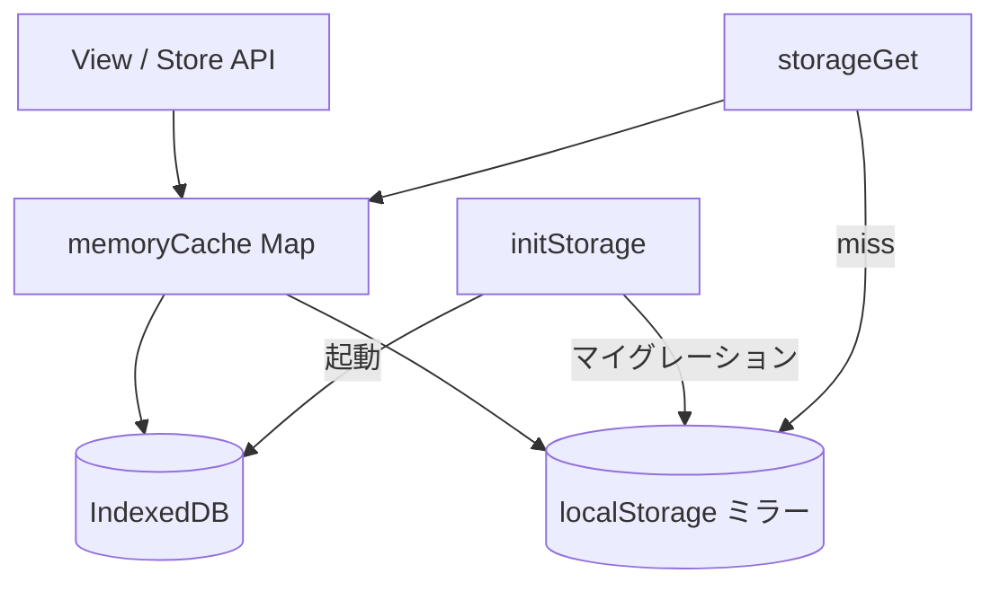
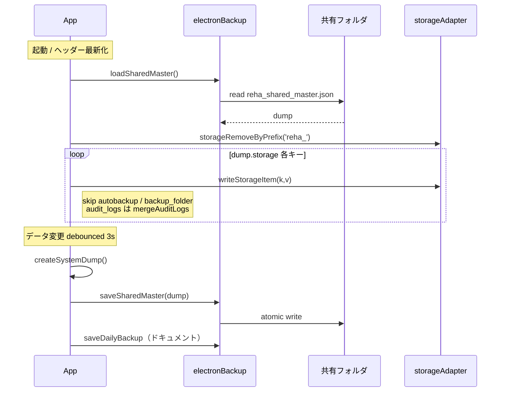
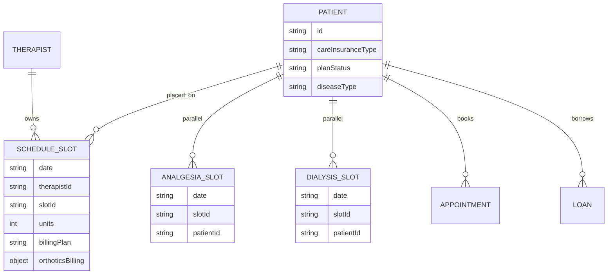
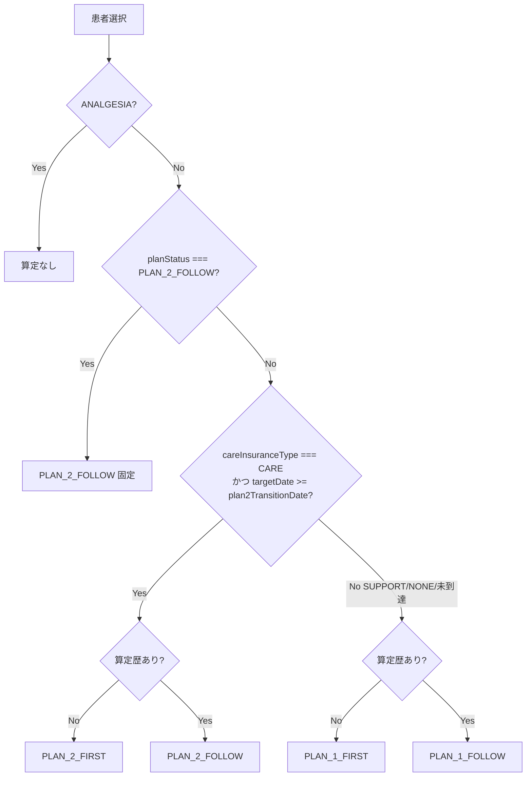
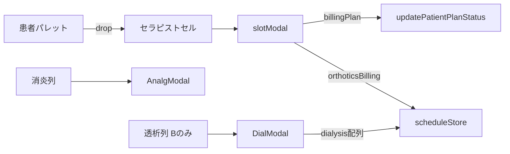

# リハビリ業務管理システム：完全アーキテクチャ設計図（システム全容解体書）

| 項目 | 内容 |
|------|------|
| **文書ID** | `SYSTEM_ARCHITECTURE_BLUEPRINT` |
| **パス** | `docs/SYSTEM_ARCHITECTURE_BLUEPRINT.md` |
| **作成日** | 2026-11-06 |
| **対象** | `reha-work-manager`（`package.json` version `1.0.0`） |
| **読者** | 保守エンジニア／第三者AI／多施設展開担当 |
| **原則** | **コード実装が正本**。本ドキュメントはリポジトリ走査時点の実装を記述する（推測で法令を書き換えない）。 |
| **関連文書** | **運用の正本:** [`docs/説明書.md`](./説明書.md)（2026-11-06 完璧運用説明書）／旧技術網羅: `COMPLETE_SYSTEM_ARCHITECTURE_SPEC.md`／`CURRENT_STATUS.md` |

---

## 目次

1. [システム全体概要・基本設計思想](#1-システム全体概要基本設計思想)
2. [ディレクトリ構造と全モジュール責務一覧](#2-ディレクトリ構造と全モジュール責務一覧)（**全ソース1ファイル1行**）
3. [多施設プロファイル完全仕様表](#3-多施設プロファイル完全仕様表)
4. [データストア設計・キー定義・永続化＆共有同期](#4-データストア設計キー定義永続化共有同期)
5. [診療報酬計算・期限判定・計画書4区分ライフサイクル](#5-診療報酬計算期限判定計画書4区分ライフサイクル)
6. [画面UI・View・モーダル層](#6-画面uiviewモーダル層)
7. [帳票出力仕様（Excel & Print）](#7-帳票出力仕様excel--print)
8. [既知の制約事項・運用注意・保守チェックリスト](#8-既知の制約事項運用注意保守チェックリスト)

---

## 1. システム全体概要・基本設計思想

### 1.1 何をするシステムか

院内リハビリテーション部門向けの **Windows Electron デスクトップアプリ**（兼・静的ホスト可能な ESM SPA）。

- **本日時間割**（セラピスト×20分コマ、消炎鎮痛並行列、施設Bのみ透析運動並行レーン）
- **外来予約カレンダー**（施設時間とは独立した提供時間）
- **月間単位・収益**（点数×10円）
- **患者台帳**（起算日・介護区分・計画書フェーズ）
- **物品貸出**
- **受付提出用Excel／業務日誌／各種A4印刷**

### 1.2 設計思想（実装から読み取れる原則）

| 原則 | 実装上の現れ |
|------|----------------|
| **単一ページ・タブ切替** | `index.html` の `.nav-tab` / `.view-panel`。司令塔は `js/app.js` |
| **時間軸の SSOT** | `timeSlotGenerator.js` → `rules.js` の `TIME_SLOTS` / `APPOINTMENT_TIME_STRINGS`（手書き固定配列禁止） |
| **報酬定数の集中** | `js/config/rules.js` の `REHA_RULES` / `ORTHOTICS_RULES` |
| **純粋計算の分離** | `deadlineCalc.js`・`validator.js` は DOM/Storage 非依存 |
| **永続化の多層化** | メモリ → IndexedDB → localStorage ミラー（`storageAdapter.js`） |
| **Electron 二重バックアップ** | 日次PCドキュメントJSON ＋ 共有フォルダ `reha_shared_master.json` |
| **多施設は機能フラグ** | `facilityConfig.js`（データ空間分離ではない。同一ストレージキーを共用） |

### 1.3 実行環境



- **appId**: `com.reha.workmanager`
- **起動**: `npm start` → `electron .` / 配布: `npm run build:win`
- **`file://` 直開きは不可**（ES modules CORS）

### 1.4 起動シーケンス（概要）



---

## 2. ディレクトリ構造と全モジュール責務一覧

> **網羅方針**: 下記は `node_modules` / ビルド成果物を除く **アプリ本体の全ソース・CSS・設定を1ファイル1行**で列挙した正本である。  
> 初版では層ごとの要約に留まっていた箇所（`views/*/`, `css/`, `backup/`, 一部 Excel・Print・履歴データ）を本節で完全化した。

### 2.1 物理ツリー（全ファイル）

```
reha-work-manager/
├── main.js
├── preload.js
├── package.json
├── index.html
├── main/
│   └── backupIpc.js
├── css/
│   ├── base.css
│   ├── style.css
│   ├── tables.css
│   ├── schedule.css
│   ├── appointment.css
│   ├── modals.css
│   └── toast.css
├── docs/                          # 設計・説明書（実行時非ロード）
└── js/
    ├── app.js
    ├── annualScoreHistorical2026.js
    ├── fy2026_annual_historical_score_data.js
    ├── config/   (3)
    ├── core/     (10)
    ├── store/    (11)
    ├── views/    (+ schedule/ appointment/ monthly/ modals/)
    ├── excel/    (+ sheets/)
    ├── print/    (10)
    ├── backup/   (2)
    ├── ui/       (2)
    └── vendor/xlsx.bundle.js
```

### 2.2 エントリ・シェル・設定

| パス | 単一責任（役割） | 主要シンボル / 備考 |
|------|------------------|---------------------|
| `main.js` | Electron メインプロセス。ウィンドウ生成・プロトコル・メニュー | `BrowserWindow` |
| `preload.js` | Renderer へ安全に IPC API を公開 | `desktopApp`, `electronBackup` |
| `main/backupIpc.js` | 日次バックアップファイル書込、共有フォルダ選択/読込/書込 IPC | `save-daily-backup-file`, `load/save-shared-master` |
| `package.json` | npm 名・version・scripts・electron-builder 設定 | `com.reha.workmanager` |
| `index.html` | 全画面 DOM・ナビタブ・全モーダル骨格・CSS/JS 読込 | `#viewSchedule` 等 |
| `js/app.js` | アプリ司令塔。起動・タブ・共有同期・施設ナビ表示制御 | `pullSharedMasterToLocal`, `pushLocalDumpToSharedMaster`, `applyFacilityNavigationFeatures` |

### 2.3 css/（スタイルシート）

| パス | 役割 |
|------|------|
| `css/base.css` | リセット・共通トークン・基本タイポ・レイアウト土台 |
| `css/style.css` | アプリシェル（ヘッダー・ナビ・パネル切替・全体トーン） |
| `css/tables.css` | 患者台帳・月間単位表など汎用テーブル見た目 |
| `css/schedule.css` | 本日時間割グリッド・カード・消炎/透析列・DnD視覚 |
| `css/appointment.css` | 外来予約カレンダー（週間/月間）専用スタイル |
| `css/modals.css` | 各種モーダル共通・フォーム |
| `css/toast.css` | トースト通知アニメ・配置 |

### 2.4 config/

| パス | 役割 | 主要 export |
|------|------|-------------|
| `js/config/rules.js` | 診療報酬定数・装具/透析定数・`TIME_SLOTS` live binding | `REHA_RULES`, `ORTHOTICS_RULES`, `reloadFacilityTimeSlots` |
| `js/config/facilityConfig.js` | 多施設プロファイル・機能フラグ・永続化・診断リロード | `FACILITY_PROFILES`, `isFeatureEnabled`, `setFacilityProfile`, `reloadForFacilityProfileChange` |
| `js/config/appointmentSlots.js` | 外来時刻配列の再エクスポート窓口 | `APPOINTMENT_TIME_STRINGS` |

### 2.5 core/

| パス | 役割 | 主要 export |
|------|------|-------------|
| `js/core/storageAdapter.js` | メモリ↔IndexedDB↔localStorage 多層永続化 | `initStorage`, `storageGet/Set/Remove`, `SCHEDULE_PREFIX` |
| `js/core/timeSlotGenerator.js` | 施設/外来時間設定からコマ配列生成・LS保存 | `generateTimeSlots`, `saveFacilityHours`, `saveOutpatientHours` |
| `js/core/deadlineCalc.js` | 算定期限・早期加算・計画推奨・13単位・日別点数 | `calculatePatientDeadlines`, `evaluateRecommendedPlan`, `getDailyBasePoints` |
| `js/core/validator.js` | 配置衝突・日上限・月計画・セラピスト負荷検証 | `validateTimeConflict`, `validateDailyLimit` 等 |
| `js/core/therapistWeeklyUnits.js` | セラピスト週単位メータ算出 | `getTherapistWeeklyUnitsMeter` |
| `js/core/therapistRoleUtil.js` | PT/OT/ST 役割判定・日別役割単位 | `getTherapistRole`, `buildDailyUnitsByRole` |
| `js/core/dataNormalizer.js` | 取込・復元時のデータ正規化 | 正規化関数群 |
| `js/core/dateUtils.js` | 日付演算・文字列化ユーティリティ | `addDays` 等 |
| `js/core/holidayCalc.js` | 祝日判定 | 祝日関連 |
| `js/core/timeSlotUtil.js` | スロット吸着・時刻ヘルパ | 吸着・比較 |

### 2.6 store/

| パス | 永続キー | 役割 |
|------|----------|------|
| `js/store/patientStore.js` | `reha_patients_master` | 患者CRUD・`planStatus`・退院/終了判定 |
| `js/store/scheduleStore.js` | `reha_schedule_YYYY-MM-DD` | コマ・`analgesia`・`dialysis`・月次集計 |
| `js/store/therapistStore.js` | `reha_therapists_master` | スタッフ・稼働・昼休み |
| `js/store/assistantStore.js` | `reha_assistant_settings` | 助手氏名 |
| `js/store/appointmentStore.js` | `reha_outpatient_appointments` | 外来予約 CRUD |
| `js/store/loanStore.js` | `reha_loans_master` | 物品貸出 |
| `js/store/auditLogStore.js` | `reha_audit_logs` | 監査ログ（共有pull時マージ） |
| `js/store/operatorStore.js` | `reha_local_operator`（LS直） | 操作者名（共有クリア対象外） |
| `js/store/archiveManager.js` | （スケジュール窓） | 冷データメモリ退避・月オンデマンド復元 |
| `js/store/storageWrite.js` | — | `writeStorageItem` ＋ 失敗トースト |
| `js/store/appointmentSync.js` | — | 予約↔時間割吸着・同期補助 |

### 2.7 views/（画面・分割モジュール・モーダル）

#### 画面エントリ

| パス | 役割 |
|------|------|
| `js/views/scheduleView.js` | 本日時間割画面の初期化・配線（子モジュール呼び出し） |
| `js/views/appointmentCalendarView.js` | 外来予約カレンダー画面の初期化・配線 |
| `js/views/monthlyView.js` | 月間単位・収益画面の初期化・配線 |
| `js/views/patientView.js` | 患者台帳 CRUD・計画フェーズ表示・患者モーダル |
| `js/views/loanView.js` | 物品貸出画面 |
| `js/views/exportView.js` | Excel出力・バックアップ／復元・共有フォルダ操作 UI |
| `js/views/auditLogView.js` | 監査ログタイムライン表示 |

#### `views/schedule/`

| パス | 役割 |
|------|------|
| `js/views/schedule/scheduleState.js` | 表示日・パレット絞り込みの画面状態 |
| `js/views/schedule/timetable.js` | グリッド描画・DnD・即配置・クイック単位・消炎/透析列 |
| `js/views/schedule/palette.js` | 患者パレット検索・ドラッグ開始 |
| `js/views/schedule/kpiStrip.js` | 当日件数 KPI ストリップ描画 |

#### `views/appointment/`

| パス | 役割 |
|------|------|
| `js/views/appointment/calendarState.js` | 表示日・表示モード・DnD中データの状態 |
| `js/views/appointment/weeklyTimetable.js` | 外来週間タイムテーブル描画 |
| `js/views/appointment/monthlyCalendar.js` | 外来月間カレンダー描画 |
| `js/views/appointment/palette.js` | 外来用患者パレット |

#### `views/monthly/`

| パス | 役割 |
|------|------|
| `js/views/monthly/monthlyState.js` | 対象年月・並び・クイックフィルタ・直近集計保持 |
| `js/views/monthly/unitsTable.js` | 月間単位表（退院グレーアウト・担当ソート） |
| `js/views/monthly/revenueDashboard.js` | 月間収益数値・本日内訳モーダル |
| `js/views/monthly/diaryPreview.js` | 業務日誌プレビュー描画 |

#### `views/modals/`

| パス | 役割 |
|------|------|
| `js/views/modals/slotModal.js` | 個別リハコマ編集（計画書・装具。透析チェックは非表示） |
| `js/views/modals/staffModal.js` | スタッフ・施設/外来時間・助手・**施設プロファイル切替** |
| `js/views/modals/analgesiaModal.js` | 消炎鎮痛並行レーン登録 |
| `js/views/modals/dialysisModal.js` | 透析運動並行レーン登録（施設B） |
| `js/views/modals/appointmentModal.js` | 外来予約の作成・編集 |

### 2.8 excel/（帳票生成）

| パス | 役割 |
|------|------|
| `js/excel/uketsukeWriter.js` | 受付提出用 Workbook 組み立て・施設Bシート分岐 |
| `js/excel/diaryWriter.js` | 業務日誌 Excel（日別シート・収益・記事） |
| `js/excel/sheetUtils.js` | 共通 STYLES・A4横印刷 OpenXML 注入 |
| `js/excel/yearlyTrendChart.js` | 年間推移シート用 Canvas→PNG チャート生成 |
| `js/excel/sheets/summarySheet.js` | レセプト収益サマリーシート |
| `js/excel/sheets/yearlyTrendSheet.js` | 年間推移表＋グラフ貼付（履歴＋ライブ合算） |
| `js/excel/sheets/individualRehaSheet.js` | 個別リハ物理タブ（PT/OT結合・SPLIT・計画記号）※現行正本 |
| `js/excel/sheets/rehaPatientSheet.js` | 旧・疾患別実施リスト（削除せず残置・互換） |
| `js/excel/sheets/analgesiaSheet.js` | 消炎鎮痛 入院/外来 物理2タブ |
| `js/excel/sheets/dialysisRehaSheet.js` | 透析加算○印マトリクス（施設B） |
| `js/excel/sheets/orthoticsSheet.js` | 装具採型採寸一覧（施設B） |
| `js/excel/sheets/patientMonthlyListSheet.js` | 実施患者一覧（単位なし・医事課向け属性表） |

### 2.9 print/（HTML印刷）

| パス | 役割 |
|------|------|
| `js/print/monthlyAuditPrint.js` | 月間点検チェックシート（赤ペン照合・透析/装具列） |
| `js/print/patientMonthlyReportPrint.js` | 患者個人月間実績表（医事課・A4横1枚） |
| `js/print/printWeeklyReceptionBook.js` | 週間予約受付簿（AM/PM 2枚・固定版） |
| `js/print/printNextWeekBookingSheet.js` | 翌週予約受付表（週ピッカー・1枚/週） |
| `js/print/outpatientWeeklyPrints.js` | 上記2帳票への互換再エクスポート |
| `js/print/handwritingWeeklyPrint.js` | → `printWeeklyReceptionBook` への互換再エクスポート |
| `js/print/weeklyPaperBookingPrint.js` | → `printNextWeekBookingSheet` への互換再エクスポート |
| `js/print/weeklyTablePrint.js` | 外来週間予約表印刷（空き行スキップで最大化） |
| `js/print/dailyChecklistPrint.js` | 本日デイリー予約チェック表（A4縦） |
| `js/print/appointmentTicketPrint.js` | 次回予約票（A5）即時印刷 |

### 2.10 backup / ui / vendor / 履歴データ

| パス | 役割 |
|------|------|
| `js/backup/backupService.js` | 手動バックアップ・年度確定・JSON復元・`createSystemDump` 統括 |
| `js/backup/localFileBackup.js` | Electron 日次自動バックアップ UI ヘルパ（フォルダ開く等） |
| `js/ui/toast.js` | 画面共通トースト `showToast` |
| `js/ui/sharedFolderUi.js` | 共有フォルダ状態ランプ／Excel画面の選択・変更 UI |
| `js/vendor/xlsx.bundle.js` | SheetJS バンドル（Excel生成ランタイム） |
| `js/fy2026_annual_historical_score_data.js` | 2026年1〜9月点数票確定値データ本体 |
| `js/annualScoreHistorical2026.js` | 上記データのエイリアス re-export |

### 2.11 docs/（非実行・参照文書）

| パス | 役割 |
|------|------|
| `docs/SYSTEM_ARCHITECTURE_BLUEPRINT.md` | **本設計書**（システム全容解体書・技術正本） |
| `docs/説明書.md` | **完璧運用説明書**（画面操作・帳票・禁止・トラブル・施設切替の運用正本） |
| `docs/COMPLETE_SYSTEM_ARCHITECTURE_SPEC.md` | 2026-10-23 版の詳細仕様（旧・網羅） |
| `docs/PROJECT_FULL_SNAPSHOT.md` | プロジェクトスナップショット |
| `docs/CURRENT_STATUS.md` | 進捗・現状メモ（古い記述混在の可能性） |
| `docs/PROMPT_FOR_INSTANT_DROP_AND_SMART_UNITS.md` | 即配置・スマート単位向けプロンプト記録 |

### 2.12 モジュール依存の俯瞰



---

## 3. 多施設プロファイル完全仕様表

### 3.1 プロファイル定義（`js/config/facilityConfig.js`）

| ID | shortName | name | 用途 |
|----|-----------|------|------|
| `HOSPITAL_A`（**デフォルト**） | 伊藤内科 | 伊藤内科（外来予約・物品あり） | 自院・全機能従来動作 |
| `HOSPITAL_B` | いとう腎クリニック | いとう腎クリニック（透析運動加算・装具採型あり） | 他院・透析/装具ON・外来予約/物品OFF |

### 3.2 機能フラグ一覧

| featureKey | HOSPITAL_A | HOSPITAL_B | 主な連動先 |
|------------|:----------:|:----------:|------------|
| `hasOutpatientReservation` | true | false | ナビ「外来予約カレンダー」表示（`app.js`） |
| `hasInventoryManagement` | true | false | ナビ「物品貸出」表示 |
| `hasAnalgesia` | true | true | 消炎レーン・Excel消炎タブ（両院あり） |
| `hasDialysisReha` | false | true | 透析並行レーン・日誌/点検/Excel透析シート |
| `hasOrthoticsBilling` | false | true | slotModal装具入力・日誌/点検/Excel装具シート |

> **重要**: フラグは **UI/帳票の出し分け**のみ。ストレージキーは施設間で共有（施設ごとのデータパーティションではない）。

### 3.3 永続化・切替機構

| 項目 | 値 |
|------|-----|
| 主キー | `localStorage['reha_facility_profile_id']` |
| バックアップキー | `localStorage['reha_facility_profile_id_backup']` |
| sessionバックアップ | `sessionStorage['reha_facility_profile_id']`（LS検証失敗時フォールバック） |
| 読込API | `getCurrentFacilityId()` → 未設定/不正時は必ず `HOSPITAL_A` |
| 書込API | `setFacilityProfile(id)` → setItem直後の getItem 検証。失敗時 false |
| UI入口 | スタッフ設定 `#settingFacilityProfileSelect`（`staffModal.js`） |
| 切替タイミング | **全スタッフ/時間/助手保存成功後**にプロファイル保存→再読込（change即リロードは廃止済） |
| 再読込 | `reloadForFacilityProfileChange({ delayMs:700, expectedId })` → `location.replace(?_facility=&_facilityReload=ts)` |



### 3.4 ナビ動的制御

`js/app.js` → `applyFacilityNavigationFeatures()`（`initNavigationTabs` 内）:

- `hasOutpatientReservation === false` → `#viewAppointmentCalendar` タブ `display:none`
- `hasInventoryManagement === false` → `#viewLoan` タブ `display:none`
- **要素は remove しない**（DOM参照副作用防止）

---

## 4. データストア設計・キー定義・永続化＆共有同期

### 4.1 多層ストレージ（`storageAdapter.js`）



| 層 | 役割 |
|----|------|
| メモリ | 同期高速読取。スケジュールはアクティブ窓のみ常駐可 |
| IndexedDB | 大容量正本（非同期 put） |
| localStorage | ミラー／フォールバック |

**例外（アダプタ外の直LS）**:

- `reha_facility_hours` / `reha_outpatient_calendar_hours`（`timeSlotGenerator`）
- `reha_facility_profile_id*`（`facilityConfig`）
- `reha_local_operator`（`operatorStore`）

### 4.2 キー一覧と命名規則

| キー | 格納 | 内容 |
|------|------|------|
| `reha_patients_master` | IDB+Mem+LS | 患者配列 JSON |
| `reha_therapists_master` | 同上 | セラピスト |
| `reha_assistant_settings` | 同上 | `{ assistant1, assistant2 }` |
| `reha_schedule_YYYY-MM-DD` | 同上 | 日次スケジュール（後述） |
| `reha_outpatient_appointments` | 同上 | 外来予約 |
| `reha_loans_master` | 同上 | 物品貸出 |
| `reha_audit_logs` | 同上 | 監査（共有pull時はマージ） |
| `reha_facility_hours` | **LS直** | 本日時間割の提供時間 |
| `reha_outpatient_calendar_hours` | **LS直** | 外来カレンダー専用時間 |
| `reha_facility_hours_legacy_gap_migrated_v1` | LS | 施設時間マイグレーションフラグ |
| `reha_facility_profile_id` | LS(+session) | 施設プロファイル |
| `reha_local_operator` | LS直 | 操作者（共有クリア対象外） |
| `reha_autobackup_*` / `reha_backup_folder_*` | （旧） | 共有適用時 **スキップ** |

`SCHEDULE_PREFIX = 'reha_schedule_'`

### 4.3 日次スケジュールオブジェクト構造

```json
{
  "A": { "S09_00": { "itemType": "PATIENT", "patientId": "...", "units": 3, "billingPlan": "PLAN_1_FOLLOW", "orthoticsBilling": { "typeCode": "ORTHO_SHORT_LIMB", "doctorName": "..." }, "note": "", "updatedAt": "..." } },
  "B": { },
  "analgesia": { "S09_00": ["P001", "P002"] },
  "dialysis": { "S10_00": ["P003", "P004"] }
}
```

| キー | 意味 |
|------|------|
| セラピストID（A/B/C/増員） | スロットID → コマオブジェクト |
| `analgesia` | スロットID → 患者ID配列（並行・消炎） |
| `dialysis` | スロットID → 患者ID配列（並行・透析75点）施設B |

`listTherapistIdsFromSchedule` は `analgesia` / `dialysis` を除外。

コマ種別: `PATIENT` / `TASK` / `LEAVE` / `HOLIDAY` / `SPECIAL_LEAVE`（`isNonPatientBlock`）。

### 4.4 患者マスター主要フィールド

| フィールド | 意味 |
|------------|------|
| `id`, `name`, `nameKana` | 識別 |
| `category` | `INPATIENT` / `OUTPATIENT` |
| `diseaseType` | `LOCOMOTIVE` / `CEREBROVASCULAR` / `DISUSE` / `ANALGESIA` |
| `careInsuranceType` | `NONE` / `SUPPORT` / `CARE` |
| `onsetDate` / `admissionDate` / `earlyBonusStartDate` | 起算 |
| `planStatus` | 台帳有効値: `NOT_YET` / `PLAN_1_FOLLOW` / `PLAN_2_FOLLOW` |
| `exitDate` 等 | 終了・退院 |
| `force13Limit` | 強制月13単位 |
| `defaultUnits` | 配置既定単位 |

### 4.5 Electron 共有マスター同期

#### パス

| 種別 | パス |
|------|------|
| 日次バックアップ | `%USERPROFILE%\Documents\リハ業務管理_自動バックアップ\reha_backup_YYYY-MM-DD.json`（14日ローテ） |
| 共有マスター | **ユーザーが選択した共有フォルダ** / `reha_shared_master.json` |
| 共有設定 | Electron `userData` / `reha_shared_folder_config.json` → `{ sharedFolderPath }` |

> 運用例として `\\192.168.3.240\共有フォルダ2` 等を指定する。**コードに固定UNCは埋め込んでいない**（ダイアログ選択制）。

#### dump 構造（概念）

```json
{
  "backupType": "SHARED_MASTER",
  "sharedMaster": true,
  "createdAt": "...",
  "storage": {
    "reha_patients_master": "<json string>",
    "reha_schedule_2026-11-05": "<json string>",
    "...": "..."
  }
}
```

#### Pull / Push フロー



**適用除外キー（pull時）**: `reha_autobackup_*`, `reha_backup_folder_*`, `reha_audit_logs`（後でマージ）。  
**クリア対象外**: `reha_local_operator`（prefix `reha_` だが operator は LS直・アダプタ外）。

### 4.6 ER風概念図



---

## 5. 診療報酬計算・期限判定・計画書4区分ライフサイクル

### 5.1 疾患別上限（`REHA_RULES.LIMIT_DAYS`）※コード正本

| diseaseType | 標準日数 | 正規点数 | 維持期点数 | 1/3日数 |
|-------------|---------|----------|------------|---------|
| LOCOMOTIVE（運動器Ⅱ） | **150** | 170 | 102 | **50** |
| CEREBROVASCULAR（脳血管Ⅲ） | **180** | 100 | 60 | **60** |
| DISUSE（廃用Ⅲ） | **120** | 77 | 46 | **40** |
| ANALGESIA | 9999（実質無制限） | 35 | 35 | 9999 |

> 備考: 口頭の「廃用180日」ではなく、**実装は120日**。

- 満了日 = 起算日 + (標準日数 − 1)。翌日以降が超過。
- 起算: `onsetDate || admissionDate`
- `getDailyBasePoints`: 超過後、要介護/要支援のみ `maintPoints`。医療のみは所定点数維持。

### 5.2 早期加算（入院のみ）

| フェーズ | 通算日 | 点数 |
|----------|--------|------|
| PHASE_1 | 1〜3日 | 60 |
| PHASE_2 | 4〜14日 | 25 |

起算: `earlyBonusStartDate || admissionDate`。外来・消炎は対象外。

### 5.3 総合計画評価料 4区分

| コード | 点数 | Excel短縮 |
|--------|------|-----------|
| `PLAN_1_FIRST` | 300 | `(Ⅰ初)` |
| `PLAN_1_FOLLOW` | 240 | `(Ⅰ継)` |
| `PLAN_2_FIRST` | 240 | `(Ⅱ初)` |
| `PLAN_2_FOLLOW` | 196 | `(Ⅱ継)` |

#### 推奨判定 `evaluateRecommendedPlan(patient, targetDateStr, hasPastPlan)`



- **計画2移行日**: 要介護のみ。`plan2TransitionDateStr = addDays(起算, oneThirdDays)`。`isPlan2Required = remainingDays <= 0`。
- **要支援 SUPPORT**: 日数に関係なく **常に計画1**（評価料2対象外）。
- 台帳手動 `PLAN_2_FOLLOW` は期日前でも最優先。
- コマ保存時 `updatePatientPlanStatus`: `PLAN_1_*`→`PLAN_1_FOLLOW`、`PLAN_2_*`→`PLAN_2_FOLLOW`（ダウングレード禁止）。

### 5.4 月13単位ブレーキ

`checkMonth13UnitsViolation` / `isMonth13LimitActiveOnDate` / `getSuggestedPlacementUnits`:

- 対象: 標準日数満了後の要介護・要支援、または `force13Limit`
- 上限: `REHA_RULES.LIMITS.MONTHLY_MAINTENANCE_MAX = 13`
- 消炎単位は含めない（個別リハのみ）

### 5.5 透析・装具定数（`ORTHOTICS_RULES`）

| 項目 | コード/点数 |
|------|-------------|
| 透析時運動指導等加算 | `DIALYSIS_REHA_POINTS: 75`（1回）／並行レーン `schedule.dialysis` |
| 長肢装具 | `ORTHO_LONG_LIMB` 1000 |
| 短肢装具 | `ORTHO_SHORT_LIMB` 650 |
| 体幹装具 | `ORTHO_TRUNK` 1000 |
| 靴型装具 | `ORTHO_SHOE` 400 |

円換算: 点数 × `POINT_RATE(10)`。

### 5.6 その他上限（`LIMITS`）

| キー | 値 | 意味 |
|------|-----|------|
| DAILY_STANDARD | 6 | 患者1日標準 |
| DAILY_ACUTE_MAX | 9 | 急性期特例 |
| THERAPIST_DAILY_MAX | 24 | セラピスト日上限 |
| THERAPIST_WEEKLY_MAX | 108 | 週上限 |

---

## 6. 画面UI・View・モーダル層

### 6.1 ナビタブ（`index.html`）

| data-target | 画面 | 施設フラグ |
|-------------|------|------------|
| viewSchedule | 本日時間割 | 常時 |
| viewAppointmentCalendar | 外来予約 | `hasOutpatientReservation` |
| viewMonthly | 月間単位・収益 | 常時 |
| viewPatient | 患者台帳 | 常時 |
| viewLoan | 物品貸出 | `hasInventoryManagement` |
| viewExport | Excel出力 | 常時 |

### 6.2 本日時間割

- **生成**: `FACILITY_HOURS` → `TIME_SLOTS`（20分コマ）
- **列**: 時間 | 稼働セラピスト… | 消炎鎮痛 | （Bのみ）⚡透析運動
- **操作**: 空き枠クリック→`openSlotModal`、カードDnD、パレット即配置、消炎/透析ドロップ追加
- **透析**: `dialysisModal` で複数患者並行登録。slotModal内透析チェックは常時非表示



### 6.3 外来予約

- 専用時間: `OUTPATIENT_HOURS`（施設時間と独立）
- 週間グリッド・予約モーダル・印刷（受付簿/翌週表）

### 6.4 月間・患者・物品

- **monthly**: `aggregateFromAppSchedule` ベースの単位表・収益・日誌プレビュー
- **patient**: CRUD、評価2切替日表示（CAREのみ）、期日到達時バッジ動的「計2移行」
- **loan**: 物品マスタ貸出管理

### 6.5 スタッフ設定モーダル

保存順（厳守）:

1. セラピスト氏名・ステータス・昼休み  
2. 施設時間 validate/save/reload  
3. 外来時間 validate/save/reload  
4. `updateTherapistSettings`  
5. `saveAssistantSettings`  
6. **最後に**施設プロファイル差分があれば `setFacilityProfile` → ハードリロード  

---

## 7. 帳票出力仕様（Excel & Print）

### 7.1 受付提出Excel `generateUketsukeWorkbook`

| 順序 | シート | 条件 |
|------|--------|------|
| 1 | レセプト収益サマリー | 常時 |
| 2 | 年間推移（+グラフ） | 常時 |
| 3 | 個別リハ物理タブ群 | 常時（最大分割） |
| 4 | 消炎鎮痛(入院) / (外来) | 該当者のみ |
| 5 | 透析時運動加算 | `hasDialysisReha` かつ件数>0 |
| 6 | 装具採型採寸料 | `hasOrthoticsBilling` かつ件数>0 |
| 7 | 患者月間一覧 | 常時 |

#### 個別リハ（`individualRehaSheet.js`）

- PT/OT 縦方向結合マトリクス、日別単位
- 当月要介護切替の **SPLIT_NORMAL / SPLIT_REDUCED** 日割り
- 計画列: `5/12\n(Ⅰ初)` 等（`formatBillingPlanTag`）
- 印刷: A4横 `fitToWidth:1`（`sheetUtils` OpenXML注入）

#### 消炎（`analgesiaSheet.js`）

- 入院・外来 **物理2タブ**、○印・回数

#### 透析（`dialysisRehaSheet.js`）

- タイトル青 `#0284C7`、実施日○（背景 `#E0F2FE`）、回数×75点

#### 装具（`orthoticsSheet.js`）

- 実施日順一覧、合計行、紫系ヘッダ

### 7.2 業務日誌 `diaryWriter.js`

- 日別シート: 出勤、担当単位、入院/外来疾患収益、計画件数
- 施設B: 集計に透析/装具行、記事欄に装具自動印字
- A4横 fitToWidth/Height 1

### 7.3 HTML印刷（`js/print/`）

| モジュール | 用途 | レイアウト |
|------------|------|------------|
| `monthlyAuditPrint.js` | 月間点検・赤ペン | A4 landscape、施設Bで透析/装具列 |
| `patientMonthlyReportPrint.js` | 個人月間・医事課 | A4横1枚、PT/OT分離、Bで透析KPI/行 |
| `printWeeklyReceptionBook.js` | 週間予約受付簿 | AM/PM 2枚、rowspanなし |
| `printNextWeekBookingSheet.js` | 翌週予約表 | 週ピッカー・バッチ |
| `dailyChecklistPrint.js` / `appointmentTicketPrint.js` 等 | 補助帳票 | — |

共通: `@page { size: A4 landscape }`、印刷色調整 `print-color-adjust: exact`。

### 7.4 帳票データソース対応表

| 実績 | データ源 |
|------|----------|
| 個別リハ単位 | `schedule[therapist][slot]` |
| 計画書 | `item.billingPlan` |
| 消炎 | `schedule.analgesia` |
| 透析 | `schedule.dialysis`（＋旧 `isDialysisReha` 互換） |
| 装具 | `item.orthoticsBilling` |

---

## 8. 既知の制約事項・運用注意・保守チェックリスト

### 8.1 制約（設計上の限界）

1. **多施設はフラグ切替のみ** — 患者・スケジュールは施設間で同一キー。別病院データを同居させると混線する。
2. **施設切替はフルリロード依存** — WindowsでLSフラッシュ遅延の可能性があるため検証・sessionバックアップ・cache-bustを実装済みだが、根本は「施設＝データ空間」ではない。
3. **自動テストほぼ無し** — 報酬ライフサイクル変更は手動回帰必須。
4. **廃用標準日数はコード上120日** — ドキュメント口頭の180と不一致に注意。
5. **共有マスターpullはローカル `reha_` を一掃して上書き** — オフライン編集の衝突解決は「後勝ち」。
6. **透析の旧スロットチェックと新レーンが併存し得る** — 帳票は両方読む互換あり。新規はレーン一本化。

### 8.2 運用注意

- 共有フォルダは **Excel出力画面**で設定（ヘッダーは状態ランプのみ）。
- 日次バックアップは Electron 起動時のみドキュメントへ自動。
- 伊藤内科に戻すと透析列・装具UIは消えるが、**過去に書いた dialysis / orthotics データはストレージに残る**。
- 要支援患者を計画2へ手動固定しない（推奨エンジンは計画1固定。台帳 `PLAN_2_FOLLOW` は強制上書き可能だが法令上不適切）。

### 8.3 保守チェックリスト

- [ ] `REHA_RULES.LIMIT_DAYS` / `PLAN_POINTS` / `EARLY_BONUS` / `ORTHOTICS_RULES` 改定時の一点修正
- [ ] `evaluateRecommendedPlan`: CAREのみ計画2、SUPPORT除外
- [ ] `listTherapistIdsFromSchedule` が `dialysis` 除外のままか
- [ ] `uketsukeWriter` の施設フラグ分岐と空シートガード
- [ ] `applyFacilityNavigationFeatures` とスタッフ設定セレクト文言の整合
- [ ] 共有pull除外キー一覧の維持
- [ ] Electron `Documents\リハ業務管理_自動バックアップ` 書込権限
- [ ] 施設切替: DevTools で `[facilityConfig] setFacilityProfile SUCCESS` と boot snapshot 一致確認
- [ ] 印刷: A4横1ページ幅（個別Excelは fitHeight 0 許容のシートあり）

### 8.4 変更時の推奨テストシナリオ（手動）

1. 伊藤内科: 全タブ表示・透析列なし・装具UIなし・Excelに透析/装具タブなし  
2. いとう腎クリニック切替→リロード後: 外来/物品タブ非表示、透析レーン表示  
3. 透析レーンに2名並行登録→日誌・点検・Excel透析シートに反映  
4. 装具算定→slot保存→Excel装具一覧・日誌記事  
5. 要介護で1/3到達→推奨が計画2、要支援は計画1のまま  
6. 共有フォルダpull後、他PCの当日スケジュールが一致  

---

## 付録A. 用語集

| 用語 | 意味 |
|------|------|
| コマ / スロット | 20分単位の時間枠（`TIME_SLOTS[].id`） |
| 並行レーン | セラピスト列外の消炎/透析。同一時刻に複数患者可 |
| 計画書4区分 | 総合計画評価料の算定種別コード |
| 共有マスター | 院内LAN上の `reha_shared_master.json` |
| SSOT | Single Source of Truth（時間軸は generator） |

## 付録B. 文書改定履歴

| 日付 | 内容 |
|------|------|
| 2026-11-06 | 初版。多施設・透析レーン・装具・共有同期・報酬ライフサイクルをコード走査に基づき統合 |
| 2026-11-06 | §2を全ファイル個別責務表に拡張（css / views分割 / excel全sheet / print全件 / backup・ui・履歴データ） |

---

**以上。実装と齟齬がある場合はコードを正とし、本設計書を更新すること。**
