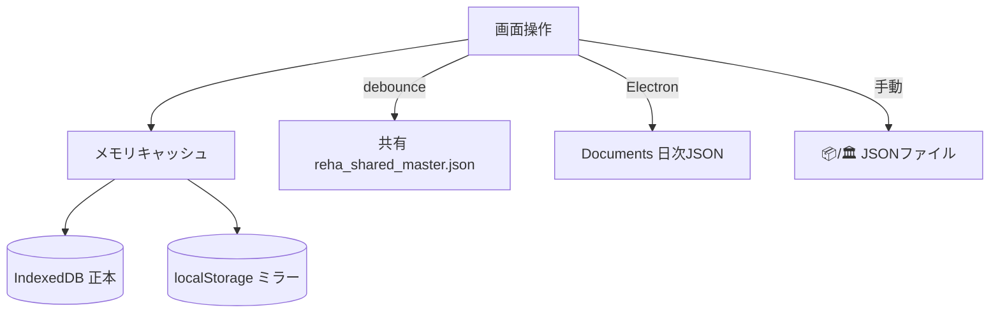

# リハビリ業務管理システム — 完璧運用説明書

| 項目 | 内容 |
|------|------|
| **文書名** | 現場・管理者・保守のための完全説明書 |
| **パス** | `docs/説明書.md` |
| **最終更新** | 2026-11-06 |
| **実装正本** | 本リポジトリのソースコード（推測で法令を書き換えない） |
| **技術解体書** | [`docs/SYSTEM_ARCHITECTURE_BLUEPRINT.md`](./SYSTEM_ARCHITECTURE_BLUEPRINT.md)（ファイル責務・データフロー・同期・報酬エンジン） |
| **対象読者** | 現場スタッフ／医事・受付連携／施設管理者／保守エンジニア／引き継ぎAI |

> **この説明書の約束**  
> 「画面で何ができるか」「いつ・何を押すか」「何が自動で起きるか」「やってはいけないこと」を、**現行コードと一致する事実だけ**で記述する。  
> モジュール内部の全関数一覧は **アーキテクチャ設計図** を正とし、本書は **運用手順の正本** とする。

---

## 目次

1. [文書の読み分け・システム概要](#1-文書の読み分けシステム概要)
2. [起動・終了・操作者設定](#2-起動終了操作者設定)
3. [多施設プロファイル（伊藤内科／いとう腎クリニック）](#3-多施設プロファイル伊藤内科いとう腎クリニック)
4. [ヘッダー共通操作](#4-ヘッダー共通操作)
5. [本日時間割](#5-本日時間割)
6. [外来予約カレンダー](#6-外来予約カレンダー)
7. [月間単位・収益](#7-月間単位収益)
8. [患者台帳](#8-患者台帳)
9. [物品貸出](#9-物品貸出)
10. [Excel出力・バックアップ・共有同期・監査ログ](#10-excel出力バックアップ共有同期監査ログ)
11. [スタッフ設定（時間・助手・施設切替）](#11-スタッフ設定時間助手施設切替)
12. [印刷帳票一覧（HTML）](#12-印刷帳票一覧html)
13. [診療報酬・期限・計画書ルール（実装どおり）](#13-診療報酬期限計画書ルール実装どおり)
14. [データが消えない仕組み](#14-データが消えない仕組み)
15. [日常運用チェックリスト](#15-日常運用チェックリスト)
16. [禁止事項・よくある失敗](#16-禁止事項よくある失敗)
17. [トラブルシューティング](#17-トラブルシューティング)
18. [付録：用語・キー・文書マップ](#18-付録用語キー文書マップ)

---

## 1. 文書の読み分け・システム概要

### 1.1 どの文書を読むか

| 知りたいこと | 読む文書 |
|--------------|----------|
| 毎日の操作・帳票・禁止事項 | **本説明書** |
| 全ファイルの役割・同期フロー・計算アルゴリズム | `SYSTEM_ARCHITECTURE_BLUEPRINT.md` |
| 旧版の長大な技術仕様（2026-10） | `COMPLETE_SYSTEM_ARCHITECTURE_SPEC.md` |
| 画面ラベルの要約（古くなり得る） | `CURRENT_STATUS.md` |

### 1.2 システムが担う業務

| 領域 | 内容 |
|------|------|
| 本日時間割 | セラピスト×20分コマ、業務/有休、消炎鎮痛列、（施設B）透析運動並行レーン |
| 外来予約 | 実時間予約、週間/月間、受付簿・翌週表・デイリー・予約票印刷 |
| 月間 | 単位表、収益、日誌プレビュー、点検印刷 |
| 患者台帳 | 疾患・起算・介護区分・計画書フェーズ |
| 物品 | 装具・備品の貸出/返却（施設Aのみナビ表示） |
| Excel | 受付提出・業務日誌・（施設B）透析/装具シート |
| 保全 | PC日次自動バックアップ、共有マスター同期、手動JSON |

### 1.3 実行形態

| 形態 | 使い方 |
|------|--------|
| **Electron（推奨・現場）** | インストール済み EXE、または `npm start` |
| 静的ホスト SPA | http(s) で配信された `index.html` |
| **不可** | `index.html` をエクスプローラーからダブルクリック（`file://`） |

- 製品内部名: `reha-work-manager` / appId `com.reha.workmanager`
- Excelエンジンは `js/vendor/xlsx.bundle.js` に内包（オフライン出力可）

---

## 2. 起動・終了・操作者設定

### 2.1 現場での起動

1. 「リハビリ業務管理システム」を起動する。
2. 初回〜共有フォルダ設定済み時は、起動直後に **共有マスターの pull** が走ることがある（数秒待つ）。
3. ヘッダーにタブが出れば起動完了。

### 2.2 開発起動・インストーラ

```bash
cd reha-work-manager
npm install
npm start          # Electron 起動
npm run build:win  # Windows インストーラ → dist/
```

### 2.3 操作者（このPCの担当者）

| 操作 | 手順 |
|------|------|
| 初回 | 起動後のモーダルで担当者を選び「このPCに固定する」 |
| 変更 | ヘッダー「👤 操作者」横の「変更」 |
| 保存先 | このPCの localStorage（`reha_local_operator`）。**共有マスター上書きの対象外** |
| 用途 | 監査ログに「誰が・どの端末で」を記録 |

パスワードログインはない。PC単位の固定名である。

### 2.4 終了

ウィンドウを閉じる。未保存の「モーダル編集中」は破棄されるが、**すでに保存した配置・台帳は IndexedDB / 自動バックアップ /（設定時）共有へ反映済み**。

---

## 3. 多施設プロファイル（伊藤内科／いとう腎クリニック）

本システムは **同一インストールで2施設の機能セットを切替**できる。  
**データ領域は施設ごとに分かれない**（患者・時間割キーは共通）。別病院のデータを同じPCに混ぜないこと。

### 3.1 機能対照表

| 機能 | 伊藤内科 `HOSPITAL_A`（既定） | いとう腎クリニック `HOSPITAL_B` |
|------|:-----------------------------:|:--------------------------------:|
| 正式名称 | 伊藤内科（外来予約・物品あり） | いとう腎クリニック（透析運動加算・装具採型あり） |
| 外来予約カレンダータブ | ✅ 表示 | ❌ 非表示（DOMは残置） |
| 物品貸出タブ | ✅ 表示 | ❌ 非表示 |
| 消炎鎮痛レーン | ✅ | ✅ |
| 透析時運動指導等加算レーン（⚡・75点） | ❌ | ✅ |
| 装具採型採寸料（コマ入力・帳票） | ❌ | ✅ |
| Excel 透析シート / 装具シート | 出ない | 実績があるとき追加 |

### 3.2 切替手順（必ずこの順）

1. ヘッダー **⚙ スタッフ設定** を開く。
2. セラピスト・時間・助手など、必要な項目を編集する。
3. 下部の **🏥 施設プロファイル切替** で施設を選ぶ。
4. **保存** を押す（選択した瞬間のリロードはしない。保存成功後に切替）。
5. プロファイル保存が成功すると、約0.7秒後に **画面がハードリロード**される（URLに `_facility` 等のキャッシュ回避クエリが付く）。
6. リロード後、ナビタブと時間割列が施設に合わせて変わることを確認する。

失敗時はトーストで知らせ、リロードしない（途中状態の施設IDと画面の食い違いを防ぐ）。

### 3.3 切替時の注意

- 施設Bで登録した `dialysis` や装具データは、伊藤内科に戻しても **ストレージ上は残る**（列やUIが消えるだけ）。
- 共有フォルダを使っている院内では、**全PCで同じ施設プロファイル運用方針**を決めてから切替える。

---

## 4. ヘッダー共通操作

| UI | 役割 |
|----|------|
| ナビ6タブ | 画面切替（施設により外来・物品は隠れる） |
| 操作者バッジ | このPCの担当者表示・変更 |
| 共有フォルダランプ | 同期状態の表示のみ。**設定変更は Excel出力画面** |
| 🔄 最新化 | 共有マスター再pull等の最新化 |
| ⚙ スタッフ設定 | スタッフ・時間・助手・施設プロファイル |

---

## 5. 本日時間割

**画面ID:** `#viewSchedule`  
**役割:** 稼働セラピスト列 × 施設提供時間の20分コマで、当日の個別リハ・業務ブロック・並行処置を管理する。

### 5.1 画面構成

| 領域 | 内容 |
|------|------|
| 日付 | 日付入力／「今日」／「🔄 更新」 |
| 予約一括反映 | 「📥 本日の予約を一括反映」（件数バッジ付き）。**手入力済み枠は上書きしない** |
| KPIストリップ | 当日件数の要約 |
| 左パレット | 患者検索・並び替え・ドラッグ元 |
| メイングリッド | 時間行 × セラピスト列 ＋ 消炎列 ＋（Bのみ）透析列 |

### 5.2 時間枠の決まり方

- **正本:** スタッフ設定の「施設リハビリ提供時間」→ `reha_facility_hours` → `TIME_SLOTS`
- コマ単位は **20分**。単位数1〜4でカード高さが連動し、連続枠は後続セルをプレースホルダで保護する。
- **昼休み**はスタッフ個別または施設標準でハイライト。昼休み帯への患者配置は誤配置防止の対象。

### 5.3 日常操作表

| やりたいこと | 操作 |
|--------------|------|
| 患者を置く | パレットから空き枠へ DnD、または空き枠「＋」→ コマモーダル |
| 単位変更 | カードクリック → モーダル、またはカード内クイック単位 |
| 担当変更・移動 | モーダルでセラピスト変更、またはカードを別枠へ DnD |
| 業務・有休・公休 | モーダル「📋 業務・会議・有休」タブ（終日/半日ワンタッチあり） |
| 消炎鎮痛 | **右端の消炎列**の枠をクリック／ドロップ → 消炎モーダル（複数患者可） |
| 透析運動加算（B） | **⚡透析列**の枠をクリック／ドロップ → 透析モーダル（1回75点・並行可） |
| 装具採型（B） | 患者コマを開き「装具採型採寸料を算定」→ 種別・医師名等を保存 |
| 外来予約を当日に反映 | 「📥 本日の予約を一括反映」（外来タブがある施設A想定） |

### 5.4 コマモーダルの要点

| 項目 | 仕様 |
|------|------|
| 患者リハ / 業務 | 上部タブで切替 |
| 単位 | 1〜4 |
| 総合計画評価料 | 4区分＋なし。同一患者・同一月の二重算定は遮断 |
| 装具 | 施設Bフラグ時に表示。長肢1000／短肢650／体幹1000／靴型400 |
| 透析チェック（旧UI） | **非表示**。透析は並行レーンが正本 |

### 5.5 自動で止まる／守られること

- 同一時刻の同一患者の二重配置 → 赤トーストで遮断
- セラピスト日24単位超 → 遮断
- 維持期等の月13単位 → 配置時にブレーキ／警告（実装の `validator` / 期限計算）
- 複数単位の「覆い」枠への上書き・予約反映スキップ

---

## 6. 外来予約カレンダー

**画面ID:** `#viewAppointmentCalendar`  
**表示条件:** 施設A（`hasOutpatientReservation`）  
**役割:** 施設時間割とは **独立した提供時間**（`reha_outpatient_calendar_hours`）上の実時間予約。

### 6.1 操作

| 操作 | 内容 |
|------|------|
| 前週／次週／今週 | 週ナビ |
| 週間 / 月間 | 表示モード切替。月間マスのダブルクリックでその週へ |
| ＋ 新規予約 | モーダルで患者・日時・所要・種別 |
| 空き余白クリック | 新規作成の入口 |
| DnD | パレット／予約カードの移動（同一患者の時間重複のみ遮断） |
| 予約票 | 保存時「🎫 保存と同時に患者さん用予約票を印刷」 |

### 6.2 印刷ボタン（外来画面）

画面上の表記と実装の対応:

| 画面ボタン | 実際の帳票 | 仕様 |
|------------|------------|------|
| 週間タイムテーブル系 | **週間予約受付簿**（`printWeeklyReceptionBook`） | A4縦・**午前／午後の2枚**。改修固定方針 |
| （動的追加）翌週系 | **翌週予約受付表**（`printNextWeekBookingSheet`） | A4縦1枚/週。週ピッカー・一括複数週可 |
| 本日デイリー | **デイリー予約チェック表** | A4縦・バインダー用 |
| （予約モーダル） | **次回予約票** | A5相当・即時 |

> 旧ボタン文言が「週間タイムテーブル」でも、配線は受付簿（AM/PM 2枚）側が正。詳細はアーキテクチャ設計図 §7。

### 6.3 時間割への反映

- 本日時間割の一括反映で、予約開始時刻を最寄り20分コマへ吸着。
- 所要分 → 単位換算。メモに `[予約 HH:MM〜]` を残す。
- 物療予約は消炎列へ。

---

## 7. 月間単位・収益

**画面ID:** `#viewMonthly`

| UI | 役割 |
|----|------|
| 年月ピッカー | 対象月。過去月はオンデマンドで IndexedDB から読込 |
| 絞り込み | 入院/外来/廃用/維持期/未算定計画/担当セラピスト等 |
| 並べ替え | 氏名・期限緊急度など |
| 点検印刷 | **月間点検チェックシート**（赤ペン用・絞り込み反映）。施設Bでは透析・装具列が増える |
| 本日／当月収益KPI | 点数×10円。本日カードで内訳 |
| 日誌プレビュー | 業務日誌の画面プレビュー |
| 単位表 | 日別単位。退院翌日以降グレーアウト等 |

**見方**

- ⚠️ … 月13単位制限の監視対象
- 計画「済」… 当月に計画評価料を算定済み
- 早▼ … 早期加算の日別内訳（入院）

患者行から個人月間実績表を出せる経路がある場合は、医事課提出用 **A4横1枚・PT/OT分離**（`patientMonthlyReportPrint`）。施設Bでは透析KPI・装具行が付く。

---

## 8. 患者台帳

**画面ID:** `#viewPatient`

### 8.1 一覧操作

検索・入院/外来・状態・並び替え（算定期限が近い順など）・「＋ 新規患者登録」。

### 8.2 登録・編集で重要な項目

| 項目 | 意味・影響 |
|------|------------|
| 患者ID・氏名・かな | 検索・帳票のキー |
| 区分 | 入院 / 外来 |
| 疾患 | 運動器 / 脳血管 / 廃用 / 消炎鎮痛 → **日数上限・点数** |
| 発症日または入院日 | 標準算定の起算（初日算入） |
| 早期加算起算 | 未入力時は入院日 |
| 介護保険 | なし / 要支援 / **要介護** |
| 計画書ステータス | 未算定 / 計画1継続 / 計画2継続（台帳の保存値） |
| 個別13単位制限 | 強制で月13監視対象にする |
| 終了日・退院日 | 以降の配置・表示判定 |

### 8.3 総合計画評価料2（要介護のみ）

- **要介護**のみ、起算から疾患の **1/3日数**経過日が「評価2切替日」。
- 切替日到達後、一覧は「計2移行」等を動的表示し、編集モーダルのセレクトも計画2側へ自動連動し得る。
- **要支援は評価料2対象外**（常に計画1系。切替日ガイドも出さない）。
- 消炎鎮痛患者は計画評価料の算定対象外。

---

## 9. 物品貸出

**画面ID:** `#viewLoan`  
**表示条件:** 施設A（`hasInventoryManagement`）

| 操作 | 内容 |
|------|------|
| 検索・フィルタ | 物品名/患者、貸出中/返却済、所有者区分 |
| ＋ 貸出登録 | 品名、患者、期間、備考 |
| 返却 | 一覧から返却処理 |

※ **診療報酬の装具採型採寸料**（施設B・コマの `orthoticsBilling`）とは別機能である。混同しない。

---

## 10. Excel出力・バックアップ・共有同期・監査ログ

**画面ID:** `#viewExport`

### 10.1 対象年月

画面上部の `exportMonthInput` で出力月を選ぶ。

### 10.2 受付提出用Excel（`uketsukeWriter`）

出力され得るシート（実装順・条件付き）:

| シート | 条件 |
|--------|------|
| レセプト収益サマリー | 常時 |
| 年間推移（＋グラフ） | 常時（2026年1〜9月は履歴確定値、以降はライブ合算の設計） |
| 個別リハ（複数物理タブ） | 常時。入院/外来×疾患×通常/減算、PT/OT縦結合、計画記号（Ⅰ初/Ⅰ継/Ⅱ初/Ⅱ継）、当月切替 SPLIT |
| 消炎鎮痛(入院) / (外来) | 該当患者がいるときのみ・**物理2タブ** |
| 透析時運動加算 | **施設B** かつ件数>0。○印マトリクス、回数×75点 |
| 装具採型採寸料 | **施設B** かつ件数>0。実施日一覧 |
| 実施患者一覧 | 常時（単位なし・属性表） |

印刷設定の基本思想: **A4横・幅に合わせる（fitToWidth）**。

### 10.3 業務日誌Excel（`diaryWriter`）

- 日別シート、担当単位、入院/外来疾患集計、出勤、助手名、本日収益（¥）
- 施設B: 透析・装具の集計行、記事欄への装具自動印字

### 10.4 PC自動バックアップ

| 項目 | 内容 |
|------|------|
| 有効条件 | Electron デスクトップ |
| 保存先 | `ドキュメント\リハ業務管理_自動バックアップ\reha_backup_YYYY-MM-DD.json` |
| ローテ | 14日超を自動削除 |
| UI | 「📂 バックアップフォルダを開く」 |

### 10.5 院内LAN共有フォルダー

| 項目 | 内容 |
|------|------|
| 設定場所 | **このExcel出力画面のみ**（ヘッダーはランプ） |
| ファイル | 選択フォルダ内の `reha_shared_master.json` |
| 設定保存 | Electron userData の `reha_shared_folder_config.json` |
| 起動時 | pull → ローカル `reha_` 系をクリアして dump 適用（一部キー除外） |
| 変更時 | デバウンス後に push ＋ 日次バックアップ |

運用例: `\\192.168.3.240\共有フォルダ2` など **ユーザーが選んだUNC**。コードに固定パスはない。

**pull時の注意:** 他PCの内容で上書きされる。オフラインで長く編集したPCを後から接続すると、**後勝ち**になる。

### 10.6 手動JSON

| ボタン | 用途 |
|--------|------|
| 📦 保存 | 随時フルダンプダウンロード |
| 🏛 確定保存 | 年度締め（改定前冷凍）想定 |
| 📥 復元 | JSON全置換 → リロード |

### 10.7 監査ログ

同一画面下部のタイムライン。カテゴリ（時間割/予約/患者/システム）と検索。操作者・端末名付き。

---

## 11. スタッフ設定（時間・助手・施設切替）

ヘッダー「⚙ スタッフ設定」。

### 11.1 保存されるもの

| ブロック | 内容 |
|----------|------|
| セラピスト | 氏名、稼働/休職/退職、増員ID、個別昼休み |
| 施設標準昼休み | 未個別設定者への適用。チェックで個別も上書き可 |
| 施設リハビリ提供時間 | **本日時間割**専用 |
| 外来カレンダー専用時間 | **外来・週間印刷**専用（時間割は変えない） |
| リハビリ助手1・2 | 日誌出勤欄 |
| 施設プロファイル | 保存成功後にリロード |

### 11.2 保存順序（実装）

スタッフ → 施設時間 → 外来時間 → 助手 → **最後に施設プロファイル** →（成功時）ハードリロード。

途中で失敗したらプロファイル切替まで進まない設計である。

---

## 12. 印刷帳票一覧（HTML）

| 帳票 | 起動場所の目安 | サイズ | 備考 |
|------|----------------|--------|------|
| 週間予約受付簿 | 外来カレンダー | A4縦×2（AM/PM） | 固定仕様 |
| 翌週予約受付表 | 外来カレンダー | A4縦×週数 | 週選択UI |
| デイリー予約チェック | 外来カレンダー | A4縦 | バインダー |
| 外来週間予約表 | （週間表印刷系） | A4横 | 空き行スキップ |
| 次回予約票 | 予約モーダル | A5系 | 即時 |
| 月間点検チェックシート | 月間「点検印刷」 | A4横 | 赤ペン。Bで透析/装具列 |
| 患者個人月間実績表 | 患者/月間系 | A4横1枚 | 医事課。PT/OT分離 |

CSSは各 `js/print/*.js` 内の `@page` / インライン。色は `print-color-adjust: exact` を用いる帳票あり。

---

## 13. 診療報酬・期限・計画書ルール（実装どおり）

**正本ファイル:** `js/config/rules.js` / `js/core/deadlineCalc.js`

### 13.1 疾患別上限・点数

| 疾患 | 標準日数 | 所定点数 | 維持期点数（要介護・要支援） | 1/3日数（計画2移行目安） |
|------|----------|----------|------------------------------|---------------------------|
| 運動器Ⅱ | **150** | 170 | 102 | 50 |
| 脳血管Ⅲ | **180** | 100 | 60 | 60 |
| 廃用Ⅲ | **120** | 77 | 46 | 40 |
| 消炎鎮痛 | 事実上無制限 | 35 | 35 | — |

- 満了日＝起算＋(標準日数−1)。**翌日以降**が超過。
- **医療のみ（介護なし）**は超過後も所定点数のまま（減算しない）。
- 円換算は **点数 × 10**。

> 「廃用180日」は **本システムの実装ではない**（120日）。

### 13.2 早期加算（入院のみ）

| 通算日 | 加算 |
|--------|------|
| 1〜3日 | ＋60点 |
| 4〜14日 | ＋25点 |
| 15日〜 | なし |

### 13.3 総合計画評価料 4区分

| コード | 意味 | 点数 | Excel略号例 |
|--------|------|------|-------------|
| PLAN_1_FIRST | 計画1 初回 | 300 | (Ⅰ初) |
| PLAN_1_FOLLOW | 計画1 継続 | 240 | (Ⅰ継) |
| PLAN_2_FIRST | 計画2 初回 | 240 | (Ⅱ初) |
| PLAN_2_FOLLOW | 計画2 継続 | 196 | (Ⅱ継) |

**推奨エンジンの要点**

1. 消炎 → 算定なし  
2. 台帳がすでに計画2継続 → 計画2継続固定  
3. **要介護**かつ切替日到達 → 計画2（初回/継続は算定歴で分岐）  
4. それ以外（要支援・医療のみ・未到達）→ 計画1（初回/継続）  
5. **要支援は日数に関係なく計画2に入らない**

同一患者・同一月の二重算定はUIで遮断。コマ保存で台帳 `planStatus` はダウングレードしない方向に更新される。

### 13.4 月13単位

- 対象: 標準日数満了後の要介護・要支援、または個別強制フラグ
- 上限: **13単位/月**（個別リハ。消炎は含めない）

### 13.5 透析・装具（施設B）

| 項目 | 点数 |
|------|------|
| 透析時運動指導等加算 | **75点/回**（`schedule.dialysis` レーンが正本） |
| 長肢装具採型採寸 | 1000 |
| 短肢装具採型採寸 | 650 |
| 体幹装具採型採寸 | 1000 |
| 靴型装具採寸 | 400 |

### 13.6 1日・人員上限

| ルール | 値 |
|--------|-----|
| 患者1日標準 | 6単位 |
| 患者1日急性期特例 | 9単位（発症14日以内の脳/廃用等・実装条件に従う） |
| セラピスト1日 | 24単位で遮断 |
| セラピスト週 | 108単位で警告 |

---

## 14. データが消えない仕組み



| 層 | 役割 |
|----|------|
| メモリ | 高速読取。スケジュールは前後約3ヶ月を常駐、他はアーカイブ |
| IndexedDB | 大容量正本 |
| localStorage | ミラー／一部設定の直保存 |
| ドキュメント日次 | PC障害時の逃げ |
| 共有マスター | 複数PCの正本共有 |
| 手動JSON | 移行・年度締め |

例外的にアダプタ外の直LS: 施設時間、外来時間、施設プロファイル、操作者。

---

## 15. 日常運用チェックリスト

### 朝

- [ ] アプリ起動、操作者名が本人か確認
- [ ] 共有ランプが想定どおり（緑/設定済み）か
- [ ] 本日時間割の日付が今日か
- [ ] （A）外来の当日予約を一括反映
- [ ] 消炎・（B）透析レーンの漏れがないか

### 配置中

- [ ] 計画書が必要な患者に正しい区分が入っているか
- [ ] 要介護の評価2切替日を過ぎていないか（台帳バッジ）
- [ ] ⚠️ 月13の警告を無視して押し切っていないか
- [ ] （B）装具は該当コマに種別が入っているか

### 月末

- [ ] 月間で絞り込み→点検印刷で赤ペン突合
- [ ] 受付提出用Excel・業務日誌Excelを出力
- [ ] （B）透析・装具シートの有無を確認
- [ ] 📦 保存（または共有・自動バックアップの日付ファイル確認）

### 施設切替時（稀）

- [ ] 切替前に 📦 保存
- [ ] スタッフ設定で保存→リロード完了を待つ
- [ ] タブ表示とレーンが施設表どおりか確認

---

## 16. 禁止事項・よくある失敗

| 禁止・失敗 | 理由 |
|------------|------|
| `index.html` を file:// で開く | モジュールが動かない |
| 共有未同期のまま長時間オフライン編集し、後から接続 | 後勝ちで上書きされ得る |
| 伊藤内科といとう腎の患者データを同一ストレージに混在運用 | 施設はフラグ切替のみ |
| 要支援を計画2で算定する運用 | システム推奨は計画1固定（法令上も評価料2対象外） |
| 透析を旧チェックとレーンの両方に二重登録 | 集計が膨らむ可能性。レーン一本化が正 |
| 復元JSONを選ぶ前にバックアップを取らない | 全置換で戻しづらい |
| スタッフ設定で施設だけ変えて保存せず閉じる | プロファイルは保存時のみ確定 |

---

## 17. トラブルシューティング

| 症状 | 確認すること |
|------|----------------|
| 画面が白い／動かない | file:// になっていないか。Electron / http(s) で開き直す |
| 外来・物品タブがない | 施設Bになっていないか（スタッフ設定） |
| 透析列が出ない | 施設Bか。リロード後か |
| 施設を切り替えたのに戻る | 保存成功トースト後のリロードまで待ったか。DevTools に facilityConfig の SUCCESS ログがあるか |
| Excelに透析シートがない | 施設Bか。当月 `dialysis` 実績が1件以上あるか |
| 共有が反映されない | Excel画面でフォルダ設定・`reha_shared_master.json` の存在・権限・他PCの最終更新時刻 |
| 単位がおかしい | 患者の起算日・介護区分・疾患。当月中満了の日割り |
| 自動バックアップがない | Electronか。`ドキュメント\リハ業務管理_自動バックアップ` の権限 |
| 予約が一括反映されない | すでに埋まっている枠はスキップ。件数バッジを確認 |

---

## 18. 付録：用語・キー・文書マップ

### 18.1 用語

| 用語 | 意味 |
|------|------|
| コマ / スロット | 20分枠（`TIME_SLOTS`） |
| 並行レーン | セラピスト列外の消炎・透析（同時刻複数可） |
| 計画書4区分 | 総合計画評価料の算定種別 |
| 共有マスター | LAN上の `reha_shared_master.json` |
| 施設プロファイル | UI/帳票の機能フラグセット（データ分離ではない） |

### 18.2 主要ストレージキー

| キー | 内容 |
|------|------|
| `reha_patients_master` | 患者 |
| `reha_schedule_YYYY-MM-DD` | 日次時間割（+analgesia +dialysis） |
| `reha_therapists_master` | スタッフ |
| `reha_assistant_settings` | 助手 |
| `reha_outpatient_appointments` | 外来予約 |
| `reha_loans_master` | 物品 |
| `reha_audit_logs` | 監査 |
| `reha_facility_hours` | 本日時間割の時間 |
| `reha_outpatient_calendar_hours` | 外来専用時間 |
| `reha_facility_profile_id` | 施設ID（+backup / session） |
| `reha_local_operator` | 操作者（共有クリア対象外） |

### 18.3 文書マップ

| 文書 | 役割 |
|------|------|
| **本説明書** | 運用・画面・禁止・トラブルの正本 |
| `SYSTEM_ARCHITECTURE_BLUEPRINT.md` | 全ファイル責務・同期・計算・帳票構造の技術正本 |
| `COMPLETE_SYSTEM_ARCHITECTURE_SPEC.md` | 旧・詳細技術仕様 |
| `説明書.md`（本ファイル） | 2026-11-06 全面改訂（多施設・透析レーン・装具・共有同期を反映） |

---

## 改訂履歴

| 日付 | 内容 |
|------|------|
| 2026-10-22 | 旧説明書（施設可変時間・Electronバックアップ1本化時点） |
| 2026-11-06 | **完璧運用説明書として全面改訂**。多施設、透析並行レーン、装具、計画2要介護限定、共有フォルダ、印刷/Excel対応表、チェックリストを実装走査に基づき統合 |

---

**実装と本説明書が食い違う場合は、コードを正し、本説明書を更新すること。**  
技術詳細・全ソース一覧は必ず `docs/SYSTEM_ARCHITECTURE_BLUEPRINT.md` と併読すること。
